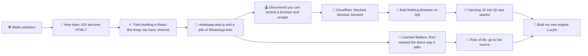

<div align="center">
  
</div>

<p align="center">
  <a href="https://git.io/typing-svg">
    
  </a>
</p>

<p align="center">
  <a href="https://wa.me/254793859108"></a>
  <a href="https://t.me/ernesttechhouse"></a>
  <a href="https://discord.gg/TUxBVQ7y"></a>
  <a href="https://www.npmjs.com/package/nothing-browser"></a>
  <a href="mailto:ernesttechhouse@gmail.com"></a>
</p>

<p align="center">
  
</p>

---

## 👋 Hey, I'm Ernest

I build things that most people look at and say *"you can't do that."* Then I do it, and then I write the documentation nobody asked for.

A year ago I was making websites. Today I'm writing a **browser engine in C++**. Somewhere in between, I got curious about how things *actually* work underneath, and I never recovered.

| | |
|---|---|
| 🔭 **Currently building** | **LucyN**, my own browser engine for [Nothing Browser](https://github.com/BunElysiaReact/nothing-browser). Headless pipeline done, window + painter next |
| 🌱 **Currently learning** | Zig, harder C++, and how far down the rabbit hole goes |
| 🧠 **Philosophy** | Don't use the abstraction. Read the protocol. Go to the source. |
| 🦸 **Hero** | [SaltyAom](https://github.com/SaltyAom), creator of Elysia.js. Obsessed admirer, no shame. |
| 😤 **Toxic relationship** | I hate Bun. I use Bun. We're working on it. |
| 🌍 **Based in** | Kenya 🇰🇪 |

---

## 🕳️ How I fell down the rabbit hole



---

## 🚀 What I've built

### 🌐 Nothing Browser
> *Does nothing... except everything that matters.*


A **scraper-first browser** for API reverse engineering, web scraping and automation research. Most browsers hide the web from you; this one exposes it.

- 🔍 Full network inspector: every request, response, WebSocket frame, cookie and storage write
- 📤 One-click export to Python `requests`, `curl_cffi`, cURL, JS fetch or raw HTTP
- 🎭 Engine-level fingerprint spoofing (UA, WebGL vendor, screen, hardware)
- 🔌 Community plugin system, in-app auto-updates, zero telemetry

| Phase | Engine | Status |
|---|---|---|
| **Phase 1** | Qt6 + Chromium WebEngine | ✅ Shipped (v0.1.9) |
| **Phase 2** | **LucyN**: my own engine, API and client | 🔨 In development, replaces the old automation library |

[📦 Repo](https://github.com/BunElysiaReact/nothing-browser) · [📚 Docs](https://nothing-browser-docs.pages.dev/guide/nothing-browser/) · [📥 Releases](https://github.com/BunElysiaReact/nothing-browser/releases)

---

### 👻 LucyN: the new phase of Nothing Browser
> *We don't care about beauty. We care about stealth, capture and truth.*


The next phase of Nothing Browser: **my own engine, its own API and client, and everything around it**, built from the ground up because injecting JS into Qt kept fighting me. It replaces Chromium *and* the old automation library. One goal: **be invisible.**

**No Qt. No Chromium. No CDP. No remote debugging ports. No automation flags. No difference between headless and headful.** The engine always presents itself as a real, human-operated browser, because as far as it's concerned, it always is. No multi-gigabyte toolchains either: Gumbo, QuickJS, stb and Mongoose live in the repo as plain vendored source.

```
libcurl ──▶ Moonbug ──▶ NULLBYTE ──▶ TinyElysia ──▶ Dashboard
 (fetch)    (capture)     (sign)       (serve)
    │
    ▼
 HTML ──▶ Gumbo ──▶ DOM ◀──▶ QuickJS (DOM bridge)
```

**✅ Built and tested**

- 🕸️ **Moonbug**: LucyN *is* the HTTP client, so it captures decrypted traffic natively. No MITM certs, no proxy, nothing a page can reach
- 🔐 **NULLBYTE**: HMAC-SHA256 signing, so captured traffic can be proven untampered
- 🧩 **TinyElysia**: HTTP + WebSocket server in C/C++ (Elysia-inspired, zero Bun), serving a live capture dashboard on localhost
- 🌳 **DOM + QuickJS bridge**: `document`, `fetch`, XHR, cookies, timers and per-origin storage, enough to scrape JS-rendered pages with no pixels
- 💉 **LucyScript**: userscripts injected through a shell page, with `@run-at start|end`, plus before/after DOM snapshots and diffs
- 🎭 **Identity profiles**: one consistent "person" per session (UA, GPU, fonts, TLS/HTTP2 fingerprint via curl-impersonate, Chrome header order). Consistency beats randomness
- ⬇️ **Streaming downloads** straight to disk, using the same identity and cookie jar
- 🔌 **JS client** over newline-delimited JSON on stdio: no TCP port, nothing the page can see, and crash-safe promises
- 📦 **Portable by design**: all data lives in `nothing-data/` next to the binary. Delete the folder and the browser forgets everything

**🔨 Coming next**

- 👻 **Ghostful Mode**: no fake headless, just a real SDL window with the curtains drawn
- 🖼️ SoftwarePainter, block/inline layout and basic flexbox
- 🛡️ Built-in ad blocker at the request layer, cookie persistence
- 🧬 Fingerprint hardening and process isolation

```js
import Lucyn from "nothing-browser";

const a = new Lucyn({ profile: "default", ghostful: true, moonbug: true });

await a.visit("https://example.com");
const title = await a.extract("title");

a.moonbug.onRequest(req => console.log(req.url));   // the wiretap, from JS
await a.close();
```

**The rendering promise:** did it render? ✅ Is it pretty? 💩 Can I scrape it? 👻

*Stealth is a measured result, not a claim: every build is checked against tls.peet.ws, bot.sannysoft.com, CreepJS and BrowserLeaks, and a failing check becomes a ticket. Named after LucyN. She knows why.* 👀

---

### 🎬 NothingMovieStore


*Your midnight cinema, always open.* A free Android app for movies, series and anime: adless streaming, offline downloads, a native video player, TMDB metadata, live channels, and weekly Saturday patches. Rebuilt from scratch in **100% native Kotlin** because the old version kept crashing and I refused to ship something that falls over.

[🌐 Website](https://nothing-movies-website.pages.dev/) · [💬 Telegram](https://t.me/nothingmoviestore)

---

## 🛠️ Tech I use

<p align="center">
  
  <br/>
  
  <br/>
  
</p>

---

## 📊 Stats

<p align="center">
  
</p>

<p align="center">
  <picture>
    <source media="(prefers-color-scheme: dark)" srcset="https://raw.githubusercontent.com/Ernest12287/Ernest12287/output/github-snake-dark.svg" />
    <source media="(prefers-color-scheme: light)" srcset="https://raw.githubusercontent.com/Ernest12287/Ernest12287/output/github-snake.svg" />
    
  </picture>
</p>

---

<div align="center">
  <a href="https://git.io/typing-svg">
    
  </a>
  <br/>
  <sub>Part of the Nothing Ecosystem · Built in Kenya 🇰🇪</sub>
</div>


